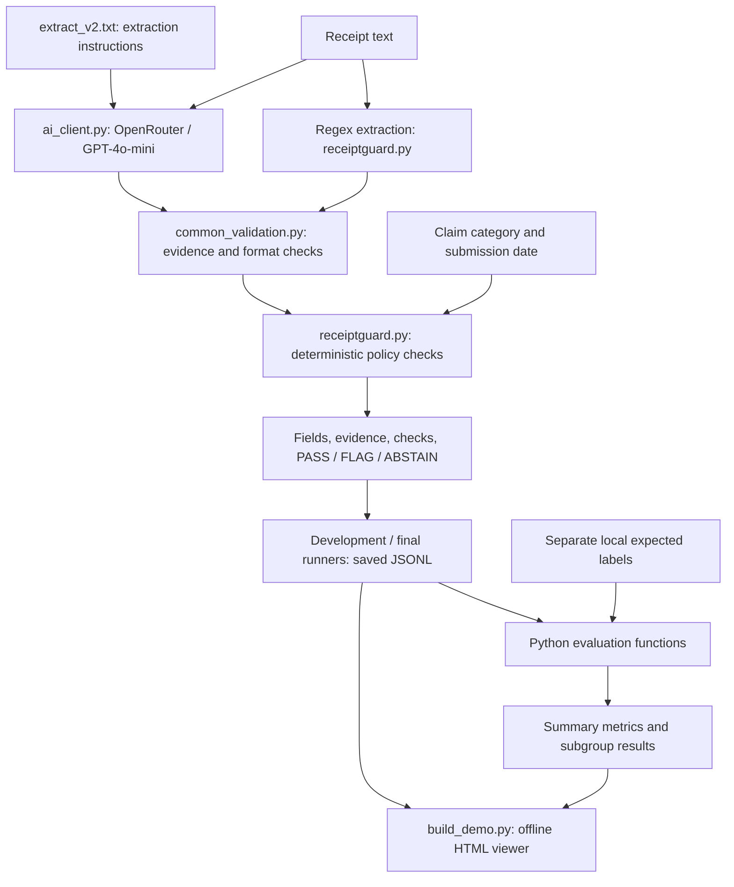

# ReceiptGuard product documentation

## Persona and intended change
A finance executive reviews meal-expense claims on a laptop. Today, that reviewer must transcribe dates, currencies and amounts and check deadlines and limits. ReceiptGuard exposes extracted fields and source evidence alongside explicit checks, so the reviewer can inspect uncertain or violating claims. The prototype has not measured time saved or been deployed to a finance team. Eighty receipts per day is a scenario assumption, not observed demand.

## Input and output contract
Input is receipt **text**, plus local claim metadata: `claim_category` and ISO `submission_date`. Photographs, PDFs and OCR are outside the implementation. Only receipt text is sent to the hosted extractor; labels and claim metadata remain local.

Required extracted fields are `receipt_date` (ISO date), `currency` (currency code) and `total` (decimal value represented as text). Missing information is represented by null. Output includes fields, source evidence, extraction issues, rule checks, review reasons and one status:

- **PASS:** supported information passes the implemented rules; this is not payment authorization.
- **FLAG:** supported information violates the amount or submission-window rule; human review is required.
- **ABSTAIN:** required information is missing, invalid, ambiguous or unsupported; human review is required. This takes precedence over FLAG.

The demo policy supports meal claims in SGD with a positive total at most SGD 50 and submission 0-30 days after purchase. Unsupported currency or category causes ABSTAIN. The HTML viewer displays saved results; optional terminal scripts make live API requests.

## Architecture

External intelligence extracts information; Python handles money, dates and scoring. There is no RAG, autonomous agent, LLM judge, tax-ID verification or subtotal-plus-tax reconciliation. Evidence substring checks reduce unsupported outputs but cannot prove that a number is semantically the total. Read the [module guide](CODE_GUIDE.md) for implementation boundaries.

## Targets, evaluation contract and reached metrics
The original proposal stated a "90% Pass Rate on policy violation detection" and an abstention target below 10%, but did not clearly define the primary metric or denominator. Correct automated handling and violation recall are different measures: the former requires the correct non-ABSTAIN status and all required fields across all 50 cases; the latter counts expected FLAG cases correctly predicted FLAG. AI reached 45/50 (90%) and 29/29 (100%), respectively. The final 90% result is therefore not direct confirmation of an unchanged original target. The originally asserted 45% Regex figure was not a measured baseline; the measured final automated-handling result is 76%. The frozen [manifest](data/frozen_v1/manifest.json) records the actual evaluation contract: all 50 cases in the denominator, no completion credit for abstention, five mandatory abstentions and a 90% maximum valid automated-completion rate. The under-10% abstention target was withdrawn before predictions because it conflicts with those five cases. The manifest records the ceiling, not a new independently registered performance target.

| Measure | Target or evaluation intent | Regex reached | AI reached |
|---|---|---:|---:|
| Correct automated handling | Final primary metric: correct non-ABSTAIN status and all required fields / all 50 cases; distinct from the original violation-detection target | 38/50 (76%) | 45/50 (90%) |
| Violation recall | Expected FLAG cases correctly predicted FLAG / all expected FLAG cases | 25/29 (86.2%) | 29/29 (100%) |
| Abstention | Replace early <10% target with mandatory vs unnecessary abstentions | 12/50; 7 unnecessary | 5/50; 0 unnecessary |
| Mandatory abstention recall | Route all five insufficient-information cases to review | 5/5 | 5/5 |
| Status routing | Diagnostic metric; no separate numeric threshold recorded | 43/50 | 50/50 |
| Total-field accuracy, including nulls | Diagnostic metric; no separate numeric threshold recorded | 43/50 | 49/50 |
| False releases | Safety intent: avoid PASS on expected non-PASS cases | 0 observed | 0 observed |
| Human review | Report workload, not an optimization target fixed before testing | 37/50 | 34/50 |

The AI improvement is seven additional correct automated decisions, or **14 percentage points**, on this challenge set. Correct handling includes FLAG: AI produced 16 PASS, 29 FLAG and five ABSTAIN, so 68% still requires review. Zero observed false releases is not proof of safety. Cost and latency were measured diagnostics, not pre-registered service-level targets: USD 0.000101859 per receipt and approximately 1.977 seconds mean AI pipeline time.

## Evidence, limits and next validation
The [evaluation explainer](results/README.md) identifies the original 24 September 2026 runs; the [data explainer](data/README.md) documents synthetic provenance and label review. Forty cases were locally generated and ten contributed by another model, with AI-assisted review before scoring and a subsequent personal review by Mao Siyi; see the [author review record](data/AUTHOR_REVIEW.md). Independent third-party annotation is not claimed. The benchmark was partly designed alongside the implementation; it cannot establish real-photo generalization.

Next work would use authorized real receipts, independent human labels and a stronger Regex baseline, then measure both extraction quality and reviewer time. These are future validation steps, not completed experiments. Changes after the frozen run must be versioned and evaluated on a new untouched test set.
